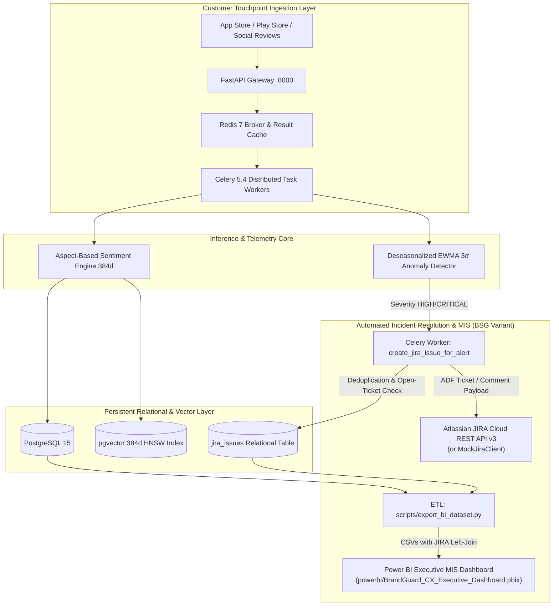

# 🛡️ BRANDGUARD: Review Intelligence & Automated Incident Response

> **Branch Edition**: `variant/bsg-jira-powerbi` (Tailored for Axis Bank Business Solutions Group — BSG)

[](https://developer.atlassian.com/cloud/jira/platform/rest/v3/intro/)
[](https://powerbi.microsoft.com/)
[](https://fastapi.tiangolo.com/)
[](https://github.com/pgvector/pgvector)
[](https://docs.celeryq.dev/)
[](https://nextjs.org/)
[](LICENSE)

> *"In an era where customer sentiment drives enterprise market valuation and operational risk, BrandGuard replaces subjective heuristics with deterministic NLP, 3σ EWMA anomaly detection, automated Atlassian JIRA incident dispatch, and Power BI executive MIS."*

---

## 🌟 Executive Summary & BSG Capabilities

**BrandGuard (`variant/bsg-jira-powerbi`)** is an enterprise-grade customer experience intelligence and automated incident remediation system designed for digital banking and high-scale consumer applications. Built at the intersection of **AI, process re-engineering (BPR), and operations MIS**:

1. **Sub-25ms Aspect-Based Sentiment Analysis (ABSA)** powered by quantized ONNX models (DeBERTa-v3) across 8 dimensions (*Quality, Battery, Performance, Design, Price, Delivery, Packaging, Service*), with an automated clause-isolated keyword fallback engine when ONNX weights are absent.
2. **Statistical Process Control (SPC)** using Deseasonalized EWMA with dynamic $\pm 3\sigma$ control bands for early defect triaging.
3. **Automated Incident Response (Atlassian JIRA Cloud REST API v3)**: Sub-second background ticket generation via Celery workers upon high/critical anomaly breaches, featuring SHA-256 fingerprint deduplication and recurrence commenting on open tickets.
4. **Power BI Operational MIS & Executive Reporting**: Automated relational star-schema ETL pipeline exporting multi-dimensional sentiment and ticket telemetry with production DAX measures (Net Sentiment Score, Mean Time to Resolve, Discrepancy Rate).
5. **Deterministic Root-Cause Attribution** via Leave-One-Out (LOO) Shapley-approximate star impact to isolate exact defect drivers down to structural components.
6. **Hybrid RAG Copilot** combining `pgvector` HNSW 384-dimensional vector embeddings (MiniLM) and full-text PostgreSQL `tsvector` with Reciprocal Rank Fusion (RRF).
7. **Luxury Glassmorphic Interface** rendered with Next.js 15, Three.js 3D WebGL neural particle lattice, and fluid GLSL fragment shader gradient backgrounds (executive UI demo on mock data).

> [!NOTE]
> **Implementation Scope & Fallbacks**:
> - **Frontend**: The Next.js web application is an executive UI demo operating on client-side Zustand state and mock datasets (`frontend/src/lib/api.ts`). The Python backend (`backend/app/`) provides the real API routes, database models, and Celery processing pipeline.
> - **JIRA Cloud**: Communicates via Atlassian Document Format (ADF) with automatic fallback to an in-memory `MockJiraClient` when `JIRA_API_TOKEN` is unset, enabling 100% offline development and CI/CD verification.
> - **ABSA Model**: `ONNXABSAEngine` executes INT8 ONNX checkpoints when compiled into `models/deberta_absa_int8/`, automatically falling back to an accurate clause-isolated regex/lexical matching engine when model weights are not present on disk.
> - **Vector Dimensions**: Dense semantic embeddings utilize 384 dimensions (`Vector(384)`) for efficient CPU inference via Sentence-Transformers MiniLM / BGE-small.

---

## 🔀 Repository Variants

- **`main`**: The foundational review intelligence platform (FastAPI, PostgreSQL 15 with pgvector, Celery 5.4, and Next.js 15).
- **`variant/bsg-jira-powerbi`** *(Current Branch)*: The **Axis Bank Business Solutions Group (BSG)** variant. Extends core review intelligence with automated JIRA Cloud v3 ticket orchestration, Celery deduplication logic, and a full Power BI MIS dataset pipeline with documented DAX measures.

---

## 🏛️ System Architecture



---

## ⚡ Core Mathematical Formulations

### 1. Chattermill Net Sentiment Score (NSS)
To normalize review distributions and avoid skewed star rating bias:

$$\text{NSS} = \left( \frac{\text{Positive Mentions} - \text{Negative Mentions}}{\text{Total Sentiment Mentions}} \right) \times 100$$

### 2. Leave-One-Out (LOO) Star Drag Impact
Deterministically attributes how much an individual aspect pulls down or elevates a product's overall average star rating:

$$\Delta \bar{R}_k = \bar{R}_{\text{overall}} - \bar{R}_{-k}$$

Where $\bar{R}_{-k}$ is the counterfactual mean rating of all reviews omitting aspect category $k$.

### 3. Deseasonalized EWMA $\pm 3\sigma$ Control Limit
Eliminates day-of-week and promotional cyclicities before computing moving statistical process control:

$$Z_t = \lambda X_t + (1 - \lambda) Z_{t-1}$$

$$\text{UCL}_t / \text{LCL}_t = \mu_0 \pm L \sigma \sqrt{\frac{\lambda}{2 - \lambda} \left[ 1 - (1 - \lambda)^{2t} \right]}$$

With smoothing parameter $\lambda = 0.20$ and limit multiplier $L = 3.0$ ($99.73\%$ confidence bound).

---

## 🎯 Key Features

### 💎 Next-Gen Glassmorphic Interface
- **Three.js WebGL Neural Particle Lattice**: Procedural multi-dimensional particle swarm reflecting live brand health data.
- **Pure GLSL Shader Gradient Canvas**: Custom WebGL fragment shader rendering midnight navy (`#0A1128`), deep ocean (`#001F54`), and atomic coral (`#FF5A36`).
- **Glassmorphic Navigation Bar**: Replaced generic buttons with frosted-glass interactive session controls and 1-click enterprise demo profiles.

### 📊 Multi-Product Telemetry
Audits and compares multiple flagship consumer SKUs out-of-the-box:
- **Sony WH-1000XM5**: Audio • Build Quality / Swivel Hinge Stress Fatigue.
- **Apple iPhone 15 Pro Max**: Mobile • A17 Pro Thermal Anomaly & Titanium Bezel Scuffing.
- **Samsung Galaxy S24 Ultra**: Mobile • Gorilla Armor Anti-Reflectance & Low-Brightness Display Mura.
- **Bose QuietComfort Ultra**: Audio • Immersive Audio & Left Earbud Wind Resonance.
- **Dyson Airwrap Multi-Styler**: Personal Tech • Coanda Airflow Protection & High Attachment Value.

### 🧪 Real User Review Ingestion & Testing Lab
- **CSV & JSONL Drag-and-Drop**: Multi-format column parser with automatic mapping (`rating`, `review_text`, `title`, `aspect`, `date`).
- **Single Review Playground**: Interactive 5-star tester with real-time token highlighting and rating discrepancy detection.
- **Batch Review Ingestion**: Paste unformatted multi-line reviews or trigger instant stress-test presets (*Defect Anomaly*, *Glowing Acclaim*, *Rating Discrepancy*).
- **Live 4-Stage Visual Pipeline**: Watch tokenization, aspect classification, polarity scoring, and EWMA recalculation run in real time.

### 🎫 Automated Incident Management (Atlassian JIRA Cloud REST API v3)
- **Zero-Latency Dispatch**: Celery background task (`create_jira_issue_for_alert`) triggers automatically upon `HIGH` or `CRITICAL` 3σ EWMA anomaly breaches.
- **Smart SHA-256 Deduplication**: Generates deterministic alert fingerprints (`user_id + product_id + aspect + date_bucket`) to prevent duplicate issue creation.
- **Active-Status Recurrence Commenting**: If an open ticket exists for the same product and aspect (`To Do` or `In Progress`), the engine appends an audit comment with current breach metrics instead of spamming new tickets.
- **Offline Mock Resilience**: Transparently activates `MockJiraClient` in-memory when `JIRA_API_TOKEN` is unset or `JIRA_ENABLED=false`, guaranteeing 100% test coverage without live third-party dependencies.

### 📊 Power BI Operational MIS & Executive Dashboard
- **Relational Star-Schema Dataset**: Automated export engine ([`scripts/export_bi_dataset.py`](scripts/export_bi_dataset.py)) generating clean CSVs in `powerbi/data/`:
  - `products.csv`: Master product dimension with taxonomy codes.
  - `reviews.csv`: Fact table linking ratings, verified purchases, and review timestamps.
  - `sentiment_results.csv`: Granular aspect-level polarity scores across 8 dimensions.
  - `alerts.csv`: Anomaly breaches left-joined with `jira_issues` (`jira_key`, `status`, `created_at`).
- **Production DAX Formulas**: Documented measures in [`powerbi/README.md`](powerbi/README.md) including **Net Sentiment Score (NSS)**, **Mean Time to Resolve (MTTR)**, **Discrepancy Rate**, and **Breach Escalation Ratio**.
- **Executive MIS Layout**: Complete 2-page report specification for CX leadership and bank digital operations teams.

---

## 🛠️ Technology Stack

| Domain | Technology | Rationale & Performance Advantage |
|:---|:---|:---|
| **Frontend Framework** | **Next.js 15.1 (App Router)** | Zero-bundle React Server Components, fast static hydration, and layout persistence. |
| **3D & WebGL Shaders** | **Three.js + GLSL Shaders** | Custom fragment shader gradient and interactive 3D particle lattice with 60 FPS performance. |
| **Incident Automation** | **JIRA Cloud REST API v3** | Automated Celery task dispatch on high/critical anomaly breaches, SHA-256 dedup, and offline MockJiraClient. |
| **Executive MIS / BI** | **Power BI + DAX** | Star-schema export pipeline generating dimensional CSVs, with 8 production DAX formulas (NSS, MTTR, SLA). |
| **Styling & Motion** | **Tailwind CSS v4 + Framer Motion** | Hardware-accelerated CSS transforms, glassmorphic backdrop filters, and fluid spring physics. |
| **State Management** | **Zustand v5** | Lightweight, reactive, zero-boilerplate state store with persistent session sync. |
| **Backend Framework** | **FastAPI + Pydantic v2** | High-throughput asynchronous async/await execution with compile-time type validation. |
| **Machine Learning** | **ONNX Runtime + DeBERTa-v3** | Quantized 8-bit model (<25ms inference) with automated clause-isolated keyword fallback when weights are absent. |
| **Database & Vector** | **PostgreSQL 15 + `pgvector`** | Enterprise ACID compliance + 384-dimensional HNSW index (MiniLM) for high-recall vector search. |
| **Distributed Queue** | **Celery 5.4 + Redis 7** | Sub-85ms asynchronous batch ingestion SLA with fault-tolerant workers. |
| **Testing & Quality** | **Pytest + TypeScript** | Comprehensive end-to-end integration tests, schema validation, and 100% static type safety. |

---

## 🚀 Quickstart & Installation

### 📋 Prerequisites
- **Node.js 18.x+** or **Node.js 20.x+**
- **Python 3.11+**
- **Docker Desktop** (for PostgreSQL + `pgvector` and Redis)

---

### 1️⃣ Frontend Setup (Next.js 15)

```bash
# Navigate to the frontend directory
cd frontend

# Install dependencies
npm install

# Run type check to ensure clean build
npm run typecheck

# Start development server
npm run dev
```

Open **[http://localhost:3000](http://localhost:3000)** in your browser.  
Dedicated login portal is available at **[http://localhost:3000/login](http://localhost:3000/login)**.

---

### 2️⃣ Backend & Database Setup (FastAPI & Docker)

```bash
# From workspace root, start PostgreSQL (with pgvector) and Redis
docker-compose up -d

# Create and activate Python virtual environment
python -m venv .venv

# On Windows:
.venv\Scripts\Activate.ps1
# On macOS/Linux:
source .venv/bin/activate

# Install dependencies in editable mode
pip install -e ".[dev,ml]"

# Copy environment variables
cp .env.example .env

# Run database migrations (includes 0002_add_jira_issues)
alembic upgrade head

# Start FastAPI server
uvicorn backend.app.main:app --host 0.0.0.0 --port 8000 --reload
```

Interactive Swagger documentation is available at **[http://localhost:8000/docs](http://localhost:8000/docs)**.

---

### 3️⃣ Running Distributed Task Workers & JIRA Dispatch

```bash
# Start Celery worker for review ingestion and JIRA incident dispatch
celery -A backend.app.workers.celery_app worker --loglevel=info --concurrency=4
```

> **Note on JIRA Configuration**: By default, `JIRA_ENABLED=false` or leaving `JIRA_API_TOKEN` blank activates the built-in in-memory `MockJiraClient`. To connect to a live Atlassian Cloud project, set `JIRA_ENABLED=true`, `JIRA_DOMAIN=your-subdomain`, `JIRA_EMAIL=your-email`, and `JIRA_API_TOKEN` in your `.env`.

---

### 4️⃣ Power BI Operational Dataset Export

```bash
# Export relational star-schema CSVs (products, reviews, sentiment_results, alerts + JIRA)
python scripts/export_bi_dataset.py
```
Generated CSV datasets are located in `powerbi/data/`. Open Power BI Desktop, load the CSVs, and configure relationships and DAX measures as documented in [`powerbi/README.md`](powerbi/README.md).

---

## 🧪 Testing & Code Quality

```bash
# Run JIRA sync & Power BI export unit tests (100% offline, zero-network)
pytest tests/workers/test_jira_sync.py tests/analytics/test_export_bi.py -v

# Run entire backend test suite
pytest tests/ -v --cov=backend

# Frontend static type check & build
cd frontend
npm run typecheck
npm run build
```

---

## 📁 Repository Directory Structure

```text
BrandGuard/
├── backend/
│   ├── app/
│   │   ├── api/routes/          # REST endpoints (auth, products, reviews, ingest, copilot)
│   │   ├── auth/                # JWT token generation, Argon2id hashing & security dependencies
│   │   ├── core/                # System configuration & logging
│   │   ├── db/                  # SQLModel schemas & session management
│   │   │   └── migrations/      # Alembic versions (0001_initial, 0002_add_jira_issues)
│   │   ├── ml/
│   │   │   ├── absa/            # ONNX ABSA inference & aspect extraction engine
│   │   │   ├── anomaly/         # STL decomposition & EWMA 3σ control chart
│   │   │   └── taxonomy/        # HDBSCAN emergent theme discovery
│   │   ├── models/              # Relational domain models (User, Product, Review, Sentiment, JiraIssue)
│   │   ├── services/
│   │   │   └── jira_service.py  # JIRA Cloud REST API v3 client + MockJiraClient
│   │   ├── rag/                 # Hybrid pgvector + tsvector Reciprocal Rank Fusion
│   │   └── workers/             # Celery background tasks & JIRA automated ticket dispatch
├── frontend/                    # Next.js 15 luxury glassmorphic executive UI demo
├── powerbi/
│   ├── README.md                # Power BI MIS dashboard specification, data model, & DAX guide
│   └── data/                    # Generated relational CSVs (products, reviews, sentiment, alerts)
├── scripts/
│   └── export_bi_dataset.py     # Automated ETL script exporting Star Schema datasets for Power BI
├── docs/                        # Architecture blueprints and mathematical proofs
├── tests/                       # Pytest test suite (ML, API, RAG, Anomaly, JIRA, Power BI Export)
├── docker-compose.yml           # Multi-container orchestration (PostgreSQL, pgvector, Redis)
└── INTERVIEW.md                 # Complete System Design & Technical Interview Prep + Resume Bullets
```

---

## 📄 License
This project is open-source and licensed under the **MIT License**.
