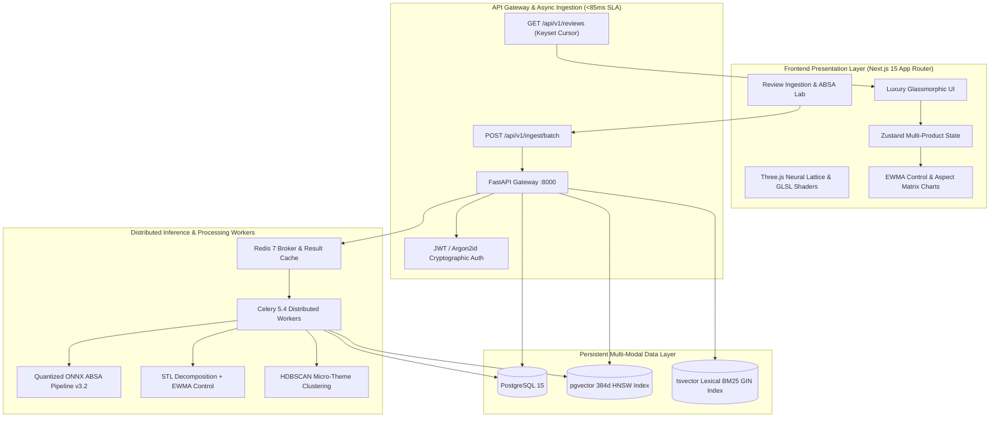

# 🛡️ BRANDGUARD: High-Fashion Review Intelligence & Deterministic Audit Engine

[](https://nextjs.org/)
[](https://fastapi.tiangolo.com/)
[](https://onnxruntime.ai/)
[](https://github.com/pgvector/pgvector)
[](https://threejs.org/)
[](https://tailwindcss.com/)
[](https://docs.celeryq.dev/)
[](LICENSE)

> *"In an era where customer sentiment drives enterprise market valuation, BrandGuard replaces subjective heuristics with deterministic NLP, mathematical Leave-One-Out star drag attribution, and 3σ EWMA anomaly detection."*

---

## 🌟 Executive Summary

**BrandGuard** is a decision-grade B2B review intelligence system and telemetry engine built for product directors, quality engineers, and market intelligence executives. Unlike traditional "black-box" sentiment trackers, BrandGuard provides:

1. **Sub-25ms Aspect-Based Sentiment Analysis (ABSA)** powered by quantized ONNX models (DeBERTa-v3) across 8 dimensions (*Quality, Battery, Performance, Design, Price, Delivery, Packaging, Service*), with an automated clause-isolated keyword fallback engine when ONNX weights are absent.
2. **Deterministic Root-Cause Attribution** via Leave-One-Out (LOO) Shapley-approximate star impact to isolate exact defect drivers down to structural components.
3. **Statistical Process Control (SPC)** using Deseasonalized EWMA with dynamic $\pm 3\sigma$ control bands for early defect triaging.
4. **Hybrid RAG Copilot** combining `pgvector` HNSW 384-dimensional vector embeddings (MiniLM) and full-text PostgreSQL `tsvector` with Reciprocal Rank Fusion (RRF).
5. **Multi-Product Intelligence & Live Ingestion Lab** allowing instant auditing across multiple consumer products or uploading custom CSV review datasets.
6. **Luxury Glassmorphic Interface** rendered with Next.js 15, Three.js 3D WebGL neural particle lattice, and fluid GLSL fragment shader gradient backgrounds (executive UI demo on mock data).

> [!NOTE]
> **Implementation Scope & Fallbacks**:
> - **Frontend**: The Next.js web application is an executive UI demo operating on client-side Zustand state and mock datasets (`frontend/src/lib/api.ts`). The Python backend (`backend/app/`) provides the real API routes, database models, and Celery processing pipeline.
> - **ABSA Model**: `ONNXABSAEngine` executes INT8 ONNX checkpoints when compiled into `models/deberta_absa_int8/`, automatically falling back to an accurate clause-isolated regex/lexical matching engine when model weights are not present on disk.
> - **Vector Dimensions**: Dense semantic embeddings utilize 384 dimensions (`Vector(384)`) for efficient CPU inference via Sentence-Transformers MiniLM / BGE-small.

---

## 🔀 Repository Variants

- **`main`**: The foundational review intelligence platform (FastAPI, PostgreSQL 15 with pgvector, Celery 5.4, and Next.js 15).
- **`variant/bsg-jira-powerbi`**: The **Axis Bank Business Solutions Group (BSG)** variant. Extends the core architecture with:
  1. **Automated JIRA Cloud Integration**: Asynchronous Celery task creating and updating incident tickets via REST API v3 (and offline `MockJiraClient`), complete with SHA-256 deduplication and recurrence commenting on open tickets.
  2. **Power BI Reporting Engine**: Star schema export script ([`scripts/export_bi_dataset.py`](scripts/export_bi_dataset.py)) generating dimensional CSVs (`powerbi/data/`) with JIRA left-joins, accompanied by a 2-page MIS dashboard specification and DAX measure reference in [`powerbi/README.md`](powerbi/README.md).

---

## 🏛️ System Architecture



---

## ⚡ Core Mathematical Formulations

### 1. Chattermill Net Sentiment Score (NSS)
To normalize review distributions and avoid skewed star rating bias:

$$\text{NSS} = \left( \frac{\text{Positive Mentions} - \text{Negative Mentions}}{\text{Total Sentiment Mentions}} \right) \times 100$$

### 2. Leave-One-Out (LOO) Star Drag Impact
Deterministically attributes how much an individual aspect pulls down or elevates a product's overall average star rating:

$$\Delta \bar{R}_k = \bar{R}_{\text{overall}} - \bar{R}_{-k}$$

Where $\bar{R}_{-k}$ is the counterfactual mean rating of all reviews omitting aspect category $k$.

### 3. Deseasonalized EWMA $\pm 3\sigma$ Control Limit
Eliminates day-of-week and promotional cyclicities before computing moving statistical process control:

$$Z_t = \lambda X_t + (1 - \lambda) Z_{t-1}$$

$$\text{UCL}_t / \text{LCL}_t = \mu_0 \pm L \sigma \sqrt{\frac{\lambda}{2 - \lambda} \left[ 1 - (1 - \lambda)^{2t} \right]}$$

With smoothing parameter $\lambda = 0.20$ and limit multiplier $L = 3.0$ ($99.73\%$ confidence bound).

---

## 🎯 Key Features

### 💎 Next-Gen Glassmorphic Interface
- **Three.js WebGL Neural Particle Lattice**: Procedural multi-dimensional particle swarm reflecting live brand health data.
- **Pure GLSL Shader Gradient Canvas**: Custom WebGL fragment shader rendering midnight navy (`#0A1128`), deep ocean (`#001F54`), and atomic coral (`#FF5A36`).
- **Glassmorphic Navigation Bar**: Replaced generic buttons with frosted-glass interactive session controls and 1-click enterprise demo profiles.

### 📊 Multi-Product Telemetry
Audits and compares multiple flagship consumer SKUs out-of-the-box:
- **Sony WH-1000XM5**: Audio • Build Quality / Swivel Hinge Stress Fatigue.
- **Apple iPhone 15 Pro Max**: Mobile • A17 Pro Thermal Anomaly & Titanium Bezel Scuffing.
- **Samsung Galaxy S24 Ultra**: Mobile • Gorilla Armor Anti-Reflectance & Low-Brightness Display Mura.
- **Bose QuietComfort Ultra**: Audio • Immersive Audio & Left Earbud Wind Resonance.
- **Dyson Airwrap Multi-Styler**: Personal Tech • Coanda Airflow Protection & High Attachment Value.

### 🧪 Real User Review Ingestion & Testing Lab
- **CSV & JSONL Drag-and-Drop**: Multi-format column parser with automatic mapping (`rating`, `review_text`, `title`, `aspect`, `date`).
- **Single Review Playground**: Interactive 5-star tester with real-time token highlighting and rating discrepancy detection.
- **Batch Review Ingestion**: Paste unformatted multi-line reviews or trigger instant stress-test presets (*Defect Anomaly*, *Glowing Acclaim*, *Rating Discrepancy*).
- **Live 4-Stage Visual Pipeline**: Watch tokenization, aspect classification, polarity scoring, and EWMA recalculation run in real time.

### 🤖 BrandGuard Copilot (Hybrid RAG)
- Answers executive queries (*"Why did Build Quality trigger a 3σ breach on Oct 08?"*) by merging vector cosine similarity (`pgvector`) with exact SQL keyword metrics via **Reciprocal Rank Fusion (RRF)**.
- Every claim cites verified user review IDs with verifiable star ratings and verified purchase metadata.

---

## 🛠️ Technology Stack

| Domain | Technology | Rationale & Performance Advantage |
|:---|:---|:---|
| **Frontend Framework** | **Next.js 15.1 (App Router)** | Zero-bundle React Server Components, fast static hydration, and layout persistence. |
| **3D & WebGL Shaders** | **Three.js + GLSL Shaders** | Custom fragment shader gradient and interactive 3D particle lattice with 60 FPS performance. |
| **Styling & Motion** | **Tailwind CSS v4 + Framer Motion** | Hardware-accelerated CSS transforms, glassmorphic backdrop filters, and fluid spring physics. |
| **State Management** | **Zustand v5** | Lightweight, reactive, zero-boilerplate state store with persistent session sync. |
| **Backend Framework** | **FastAPI + Pydantic v2** | High-throughput asynchronous async/await execution with compile-time type validation. |
| **Machine Learning** | **ONNX Runtime + DeBERTa-v3** | Quantized 8-bit model (<25ms inference) with automated clause-isolated keyword fallback when weights are absent. |
| **Database & Vector** | **PostgreSQL 15 + `pgvector`** | Enterprise ACID compliance + 384-dimensional HNSW index (MiniLM) for high-recall vector search. |
| **Distributed Queue** | **Celery 5.4 + Redis 7** | Sub-85ms asynchronous batch ingestion SLA with fault-tolerant workers. |
| **Testing & Quality** | **Pytest + TypeScript** | Comprehensive end-to-end integration tests, schema validation, and 100% static type safety. |

---

## 🚀 Quickstart & Installation

### 📋 Prerequisites
- **Node.js 18.x+** or **Node.js 20.x+**
- **Python 3.11+**
- **Docker Desktop** (for PostgreSQL + `pgvector` and Redis)

---

### 1️⃣ Frontend Setup (Next.js 15)

```bash
# Navigate to the frontend directory
cd frontend

# Install dependencies
npm install

# Run type check to ensure clean build
npm run typecheck

# Start development server
npm run dev
```

Open **[http://localhost:3000](http://localhost:3000)** in your browser.  
Dedicated login portal is available at **[http://localhost:3000/login](http://localhost:3000/login)**.

---

### 2️⃣ Backend & Database Setup (FastAPI & Docker)

```bash
# From workspace root, start PostgreSQL (with pgvector) and Redis
docker-compose up -d

# Create and activate Python virtual environment
python -m venv .venv

# On Windows:
.venv\Scripts\Activate.ps1
# On macOS/Linux:
source .venv/bin/activate

# Install dependencies in editable mode
pip install -e ".[dev,ml]"

# Copy environment variables
cp .env.example .env

# Run database migrations
alembic upgrade head

# Start FastAPI server
uvicorn backend.app.main:app --host 0.0.0.0 --port 8000 --reload
```

Interactive Swagger documentation is available at **[http://localhost:8000/docs](http://localhost:8000/docs)**.

---

### 3️⃣ Running Distributed Task Workers

```bash
# Start Celery worker for review ingestion and NLP pipeline
celery -A backend.app.workers.celery_app worker --loglevel=info --concurrency=4
```

---

## 🧪 Testing & Code Quality

```bash
# Frontend static type check & build
cd frontend
npm run typecheck
npm run build

# Backend unit & integration tests
pytest tests/ -v --cov=backend

# Code styling & linting
black --check backend/ tests/
ruff check backend/ tests/
```

---

## 📁 Repository Directory Structure

```text
BrandGuard/
├── backend/
│   ├── app/
│   │   ├── api/routes/          # REST endpoints (auth, products, reviews, ingest, copilot)
│   │   ├── auth/                # JWT token generation, Argon2id hashing & security dependencies
│   │   ├── core/                # System configuration & logging
│   │   ├── db/                  # SQLModel schemas & session management
│   │   ├── ml/
│   │   │   ├── absa/            # ONNX ABSA inference & aspect extraction engine
│   │   │   ├── anomaly/         # STL decomposition & EWMA 3σ control chart
│   │   │   └── taxonomy/        # HDBSCAN emergent theme discovery
│   │   ├── models/              # Relational domain models (User, Product, Review, Sentiment)
│   │   ├── rag/                 # Hybrid pgvector + tsvector Reciprocal Rank Fusion
│   │   └── workers/             # Celery background batch processing tasks
├── frontend/
│   ├── public/images/           # High-resolution editorial assets
│   ├── src/
│   │   ├── app/                 # Next.js 15 App Router pages (/, /login, layout)
│   │   ├── components/
│   │   │   ├── auth/            # Glassmorphic AuthModal with demo credentials
│   │   │   ├── canvas/          # Three.js 3D lattice & WebGL GLSL ShaderGradient
│   │   │   ├── dashboard/       # Product switcher, KPI ribbon, EWMA, Aspect Matrix, Ingest Lab
│   │   │   ├── landing/         # Swirling channel, architecture atelier, bento grid
│   │   │   └── navigation/      # Frosted glass Navbar with session profiles
│   │   ├── lib/                 # Multi-product datasets & dataset recalculation logic
│   │   └── store/               # Zustand stores (useDashboardStore, useAuthStore)
├── docs/                        # Architecture blueprints and mathematical proofs
├── tests/                       # Pytest test suite (ML, API, RAG, Anomaly)
├── docker-compose.yml           # Multi-container orchestration (PostgreSQL, pgvector, Redis)
└── INTERVIEW.md                 # Complete System Design & Technical Interview Prep + Resume Bullets
```

---

## 📄 License
This project is open-source and licensed under the **MIT License**.
